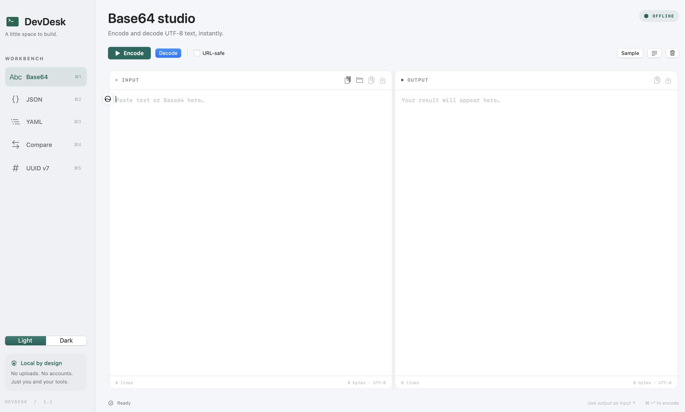

# dev-tools

A native, offline macOS workbench for everyday developer text tasks. Requires macOS 14 or later. No accounts, telemetry, uploads, package downloads, or API keys.



- **Base64:** encode/decode UTF-8 text, standard or URL-safe alphabet. URL-safe encoding omits padding. Whitespace is accepted when decoding. Binary results produce an explanatory error.
- **JSON:** validate, pretty-print, minify, and optionally sort keys. Supports top-level scalar values.
- **YAML:** validate and format YAML with two-space indentation and block-style collections using the macOS system Ruby/Psych parser. Supports multiple documents, anchors, aliases, and tags without instantiating tagged objects. Comments and original spacing are not preserved; scalar quoting styles are retained.
- **Compare:** side-by-side source texts and a colored, line-based unified diff. Optional whitespace-insensitive comparison.
- **UUID v7:** generate 1, 10, or 100 UUIDs per click, then copy or save the result. Uses the current Unix millisecond timestamp and secure random bytes according to [RFC 9562 §5.7](https://www.rfc-editor.org/rfc/rfc9562.html#section-5.7). Values within the same millisecond have random order; the generator does not enforce monotonicity when the system clock moves backward.
- **Appearance:** light mode by default, with a Light / Dark switch in the sidebar. Your choice is remembered between launches.
- Open UTF-8 files, paste, copy, save results, wrap long lines, and move output back to input. Each tool retains its own workspace while the window is open.

## Run

Open `dist/dev-tools.app` after building. You can drag it into Applications. This local build is ad-hoc signed, not notarized for public distribution.

```sh
bash scripts/build-app.sh
open dist/dev-tools.app
```

Building requires Apple's Swift command line tools (Swift 6 or newer). Swift Package Manager uses no third-party package dependencies. The build produces an app for the current Mac architecture.

## Shortcuts

| Shortcut | Action |
| --- | --- |
| ⌘1–⌘5 | Switch tools |
| ⌘Return | Encode / Format / Compare / Generate UUIDs |
| ⇧⌘Return | Decode / Minify |
| ⌘A / ⌘C / ⌘V / ⌘Z | Standard editor actions |

## Privacy and implementation

The app makes no network requests. Workspace text is held in memory and is not restored after quitting. Clipboard content remains in the system clipboard until replaced. YAML and diff operations briefly use private temporary directories that are removed after processing; saved files are written only when you choose Save. The system may still swap memory or retain files at the filesystem level.

YAML requires `/usr/bin/ruby` with Psych (available on the Mac used to build this app). Compare uses `/usr/bin/diff`. JSON formatting normalizes data through Foundation; use Compare on original text if exact numeric spelling or duplicate object keys matter. This utility is intended for normal developer text files, not enormous datasets or binary files.

## Verify

```sh
bash scripts/check.sh
```

Checks cover Unicode and URL-safe Base64, malformed input, JSON scalars and key ordering, YAML aliases/tags/multiple documents, invalid YAML, missing newlines, whitespace comparison, large subprocess input/output, and UUID v7 timestamps/version/variant/range and a 10,000-value uniqueness sample.
